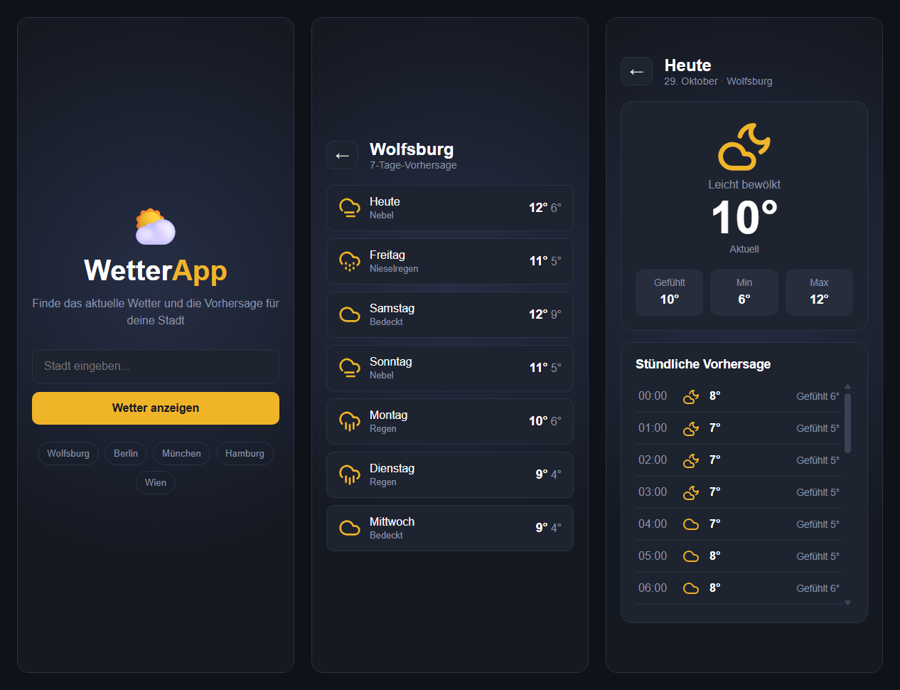
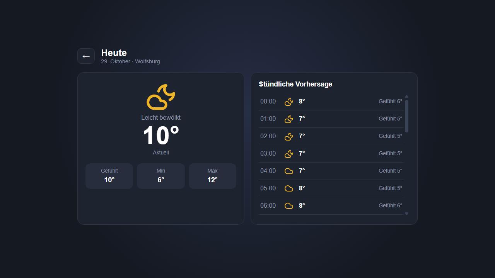

# WetterApp

Kleine Wetter-Web-App: Stadt suchen, 7-Tage-Vorhersage ansehen und für jeden Tag die Details mit Stundenverlauf öffnen. Projektaufgabe aus einem Bewerbungsverfahren (Fachinformatiker Anwendungsentwicklung).

**Live-Demo:** https://cedric-dagefoerde.github.io/wetter-app/





## Funktionen

- **Home:** Stadt eingeben und „Wetter anzeigen“ klicken – oder eine Stadt aus der Schnellauswahl anklicken
- **Wochenübersicht:** 7 Tage mit Wochentag, Wetter-Icon, Wettertext sowie Höchst- und Tiefsttemperatur; jeder Tag ist anklickbar
- **Detailansicht:** aktuelle Temperatur, gefühlte Temperatur, Minimum und Maximum des Tages, stündlicher Verlauf (scrollbar) und Zurück-Pfeil
- **Tag und Nacht:** Die Icons wechseln zwischen Sonne und Mond
- **Fehlermeldung:** Bei unbekannter Stadt oder fehlender Verbindung erscheint ein Hinweis auf der Seite
- **Responsiv:** Auf dem Handy untereinander; ab 900 px Breite zeigt die Detailansicht Wetter und Stundenliste nebeneinander

## Technik

- Reines **HTML, CSS und JavaScript** – kein Framework, kein Build-Schritt
- Wetterdaten von [Open-Meteo](https://open-meteo.com/): Geocoding-API (Stadt → Koordinaten) und Forecast-API (Wetter) – **kein API-Key nötig**
- Icons von [Lucide](https://lucide.dev/), als SVG-Dateien im Ordner `icons/`

## Projektstruktur

```
index.html            Seitenstruktur mit den drei Ansichten (home, forecast, detail)
css/style.css         Design (dunkel, gelber Akzent) und Responsive-Regeln
js/app.js             Ablauf: Suche, API-Aufrufe, Ansichten zeichnen und umschalten
js/weather-codes.js   Übersetzt den Wettercode der API in Icon und Text
icons/                Wetter-Icons (SVG)
screenshots/          Bilder für diese README
```

## Lokal starten

1. Repository herunterladen oder klonen
2. `index.html` im Browser öffnen (Doppelklick)

Eine Internetverbindung ist nötig, weil die Daten live von Open-Meteo kommen.

## So funktioniert es

1. Die Eingabe geht an die Geocoding-API und liefert die Koordinaten der Stadt.
2. Mit den Koordinaten wird die Forecast-API abgefragt – in **einer** Anfrage: aktuelles Wetter, 7 Tage, stündliche Werte und Tag/Nacht.
3. `renderWeek` zeichnet die 7 Tage, `renderDetail` den gewählten Tag. `showView` zeigt immer nur eine der drei Ansichten an.

## Entscheidungen

| Entscheidung | Grund |
|---|---|
| Reines JavaScript statt Framework | Die App ist klein; so bleibt jede Zeile nachvollziehbar und es muss nichts installiert werden |
| Open-Meteo | Kostenlos, ohne Key, liefert alles in einer Anfrage |
| Ansichten über die Klasse `hidden` umschalten | Einfachste Lösung für drei Ansichten, ganz ohne Routing |
| Icons als SVG-Dateien | Sehen überall gleich aus; Emojis dagegen je nach System unterschiedlich |
| Fehlerbehandlung mit try/catch | Unbekannte Stadt und Netzwerkfehler bekommen je eine eigene Meldung |

## Bekannte Grenzen

- Die Suche nimmt den ersten Treffer; bei gleichnamigen Städten kann das eine andere Stadt sein als gemeint
- Für spätere Tage gibt es keine „aktuelle“ Temperatur – die Detailansicht zeigt dort die Werte von 12 Uhr
- Die Wochenliste zeigt die vorherrschende Wetterlage des Tages, die Detailansicht von „Heute“ den aktuellen Zustand – Icon und Text können dort deshalb abweichen
- Der Zurück-Button des Browsers verlässt die App, weil es kein Routing gibt; in der App gibt es dafür den Zurück-Pfeil
- Keine automatisierten Tests

## Hinweis zur Entstehung

Ich habe die App mit Anleitung der KI Claude Schritt für Schritt aufgebaut, um die Grundlagen von HTML, CSS, JavaScript und API-Anbindung zu lernen. Den Code habe ich selbst eingebaut, getestet und mit Git versioniert. Das Design folgt den Design-Ideen aus der Aufgabenstellung.

## Quellen und Lizenzen

- Wetterdaten: [Open-Meteo.com](https://open-meteo.com/) (CC BY 4.0, kostenlos für nicht-kommerzielle Nutzung)
- Icons: [Lucide](https://lucide.dev/) (ISC-Lizenz)
